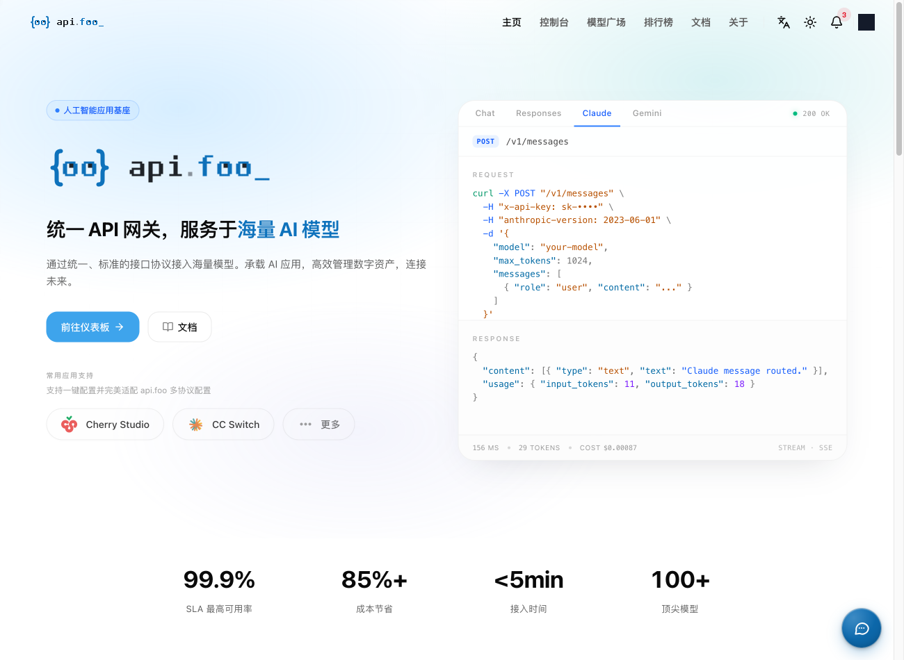
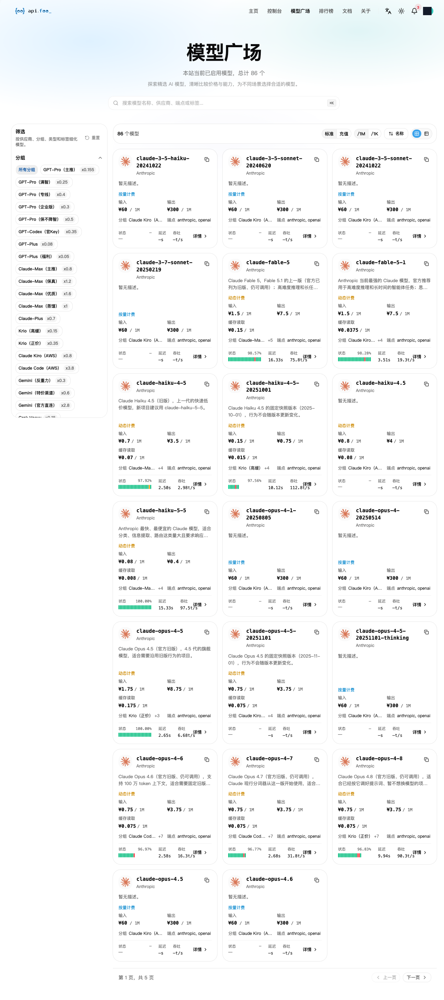
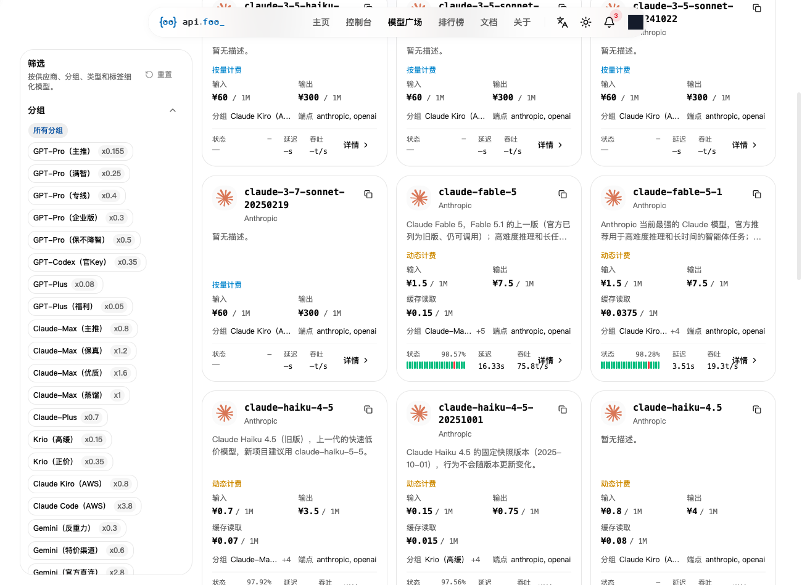

# api.foo 中转站测评：81 个模型、人民币计价，和「按次 / 按量」怎么选

api.foo 的目录里当前有 **81 个唯一型号、8 个厂商**（Anthropic 24、Google 24、OpenAI 14、xAI 11、DeepSeek 4、智谱 2、MiniMax 1、Moonshot 1）。它和多数中转站最不一样的一点是：**默认按人民币标价**，界面直接写「¥/1M token」或「¥/请求」，不需要自己换算汇率。对习惯用人民币算成本的国内团队，这一步省掉不少麻烦。

[查看 api.foo 当前模型与价格](https://api.foo/sign-up?aff=J8aF)

> **Decision:** 想要人民币直接计价、模型覆盖广（尤其 Claude 与 Gemini 各 24 个）时选它；需要按秒计费的视频生成、或只买一个最便宜模型时，换别家更合适。
>
> **For:** 用人民币做预算的国内开发者、需要 Claude / Gemini 大量变体的团队  ·  **Not for:** 视频生成需求、只追求单一最低价的用户

## 81 个型号怎么分布

| 厂商 | 型号数 | 备注 |
|---|---:|---|
| Anthropic | 24 | Claude 全系变体 |
| Google | 24 | Gemini 全系变体 |
| OpenAI | 14 | GPT 系列 |
| xAI | 11 | Grok 系列 |
| DeepSeek | 4 | 含 Flash 与 Pro |
| 智谱 | 2 | GLM |
| MiniMax | 1 | M3 |
| Moonshot | 1 | Kimi |

这个数字来自 `/api/pricing` 的真实响应，UI 上逐页点开 5 页、81 个型号各自唯一出现且有价签，不是拿首屏 20 条当全量。

顺带一个容易看错的点：界面上的 `81 Chat / 24 Anthropic / 24 Gemini / 11 Response / 5 图片` 是**重叠的端点标签**，相加不等于模型总数。

## 按量与按次，两种计费不能混着比

81 个型号里，**71 个按量、10 个按次**。按量的是「¥/1M token」，按次的是「¥/请求」。这两类放在一起比单价没有意义 —— 一个是 token，一个是次。

按量举例（¥/1M token，输入 / 输出 / 缓存读）：

| 型号 | 输入 | 输出 | 缓存读 |
|---|---:|---:|---:|
| claude-fable-5-1 | 1.5 | 7.5 | 0.0375 |
| claude-opus-5-5 | 0.6 | 3 | 0.03 |
| gpt-6.1-terra | 0.05 | 0.25 | 0.0025 |
| minimax-m3 | 1.68 | 6.72 | 0.336 |

按次举例：`gpt-image-2` ¥0.015 / 请求，`gemini-3.1-flash-image-preview` ¥0.1 / 请求。

选择顺序应该是：先确定任务是「文本/代码」还是「出图」，文本走按量、出图走按次，然后再在同一计费单位里横向比。

## 卡片上的价格不一定属于第一个分组

后台有 **43 个分组**，每组有自己的倍率。列表页显示的是「所有分组」视图下的价格，卡片上列出的第一个组加 `+N`，**不一定是最低价所属的组**。

这意味着：如果你在某个特定分组下调用，实际扣费可能和列表页看到的数字不同。下单前应该在自己的分组里确认一次单价，而不是直接按列表页的数字做预算。

## 几个要留意口径差异的型号

- **GPT-6.1 Terra**：价格表达式含 ≤272000 与 >272000 两档，长上下文单价不同，列表里的示例不是统一价。
- **Grok Imagine**：组描述写「¥0.05/张」，但 API 返回按量输入输出均 ¥3.75/1M。两种口径并列存在，实际扣费要按自己分组实测。
- **Gemini Flash Image Preview**：组描述写 ¥0.08/张，分组倍率 0.1。保留两个原始值，不强行定论。
- **MiniMax-M3**：描述写 51.2 万 token 阈值，表达式写 `len<=521000`，两者有细微差异。

这些不是缺陷，是「列表展示价」和「分组实际扣费」两套口径并存时的正常现象。做预算时按分组实价算最稳。

[按当前价目表确认自己分组的实际单价](https://api.foo/sign-up?aff=J8aF)

## 充值

满 ¥1 即可自行转入账户余额；现金提现需联系客服，规则称人工核对后 1 个工作日内到支付宝或微信、无最低金额。

## 三类任务分开建 Key

按任务倒推比按型号挑更省时间：

- **Claude 系长文与代码**：claude-opus-5-5 或 fable-5-1，看输出价与缓存读价，别只看输入价。
- **Gemini 系多模态**：Gemini 24 个变体覆盖不同上下文与模态，按具体型号的计费单位选，不要按「Gemini」统称估成本。
- **批量出图**：走按次计费的那 10 个型号，按「请求数 × 单次价」算，和 token 计费分开记。

这三类不要共用一条 Key。混用之后账单无法归因，也就没法判断哪一类该加预算、哪一类该砍。

## 它没有的东西

当前 81 个型号里没有按秒计费的视频生成供给。如果你的主任务是批量短视频，这里帮不上，应该另找有 Seedance 一类型号的站。

另外，虽然模型覆盖宽，但**同名型号在不同分组下的倍率不同**。指望「列表价就是我的价」会低估成本 —— 这条在前文已经说过，这里再强调一次，因为它是这个站最容易踩的坑。

## 适合替代哪些方案

如果你现在分别开多个模型账号、维护多套余额和多把密钥，api.foo 可以把它们收进一套人民币账单。如果你主要需求是视频生成（按秒计费的那类），这里没有对应供给，应该另找。

## 购买建议

先充一笔能覆盖几次完整任务的小额，跑通客户端、日志和扣费；确认自己所在分组的实际单价后，再决定要不要加量。第一次就大额充值，容易在口径没核清前锁住预算。

[从小额开始跑通一次完整调用](https://api.foo/sign-up?aff=J8aF)

## Related guides

同账号其他中转站测评，按场景配着看：

- [TeamoRouter 测评](https://github.com/cw11ark/teamorouter-review) —— 美元计价、含 Seedance 按秒视频，和这里的人民币纯文本正好互补
- [哈基米 API 测评](https://github.com/cw11ark/hakimi-api-review) —— 261 个模型、生图按次，模型覆盖更宽
- [HC 网关测评](https://github.com/cw11ark/hc-api-review) —— 免费层起步，适合先验证需求再付费

## FAQ

### 人民币计价需要自己换算美元吗？

不需要。界面默认就是 ¥/1M token 与 ¥/请求。但不同分组倍率不同，实际扣费以自己分组为准。

### 81 个型号都是独立的吗？

是 81 个唯一型号。界面上的端点标签（Chat / Anthropic / Gemini / Response / 图片）是重叠的，不能相加。

---

如果这篇帮你省了比价时间，给这个仓点个 star，价目和分组变动时会在这里更新。
